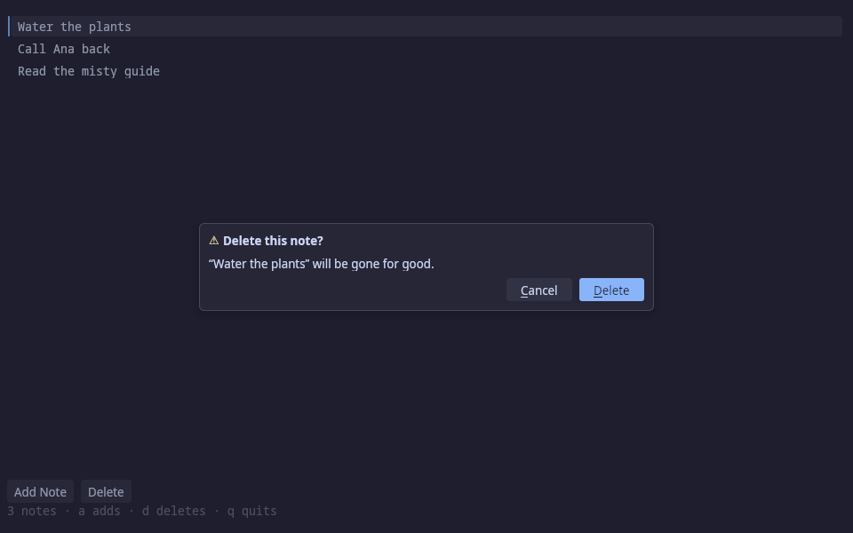
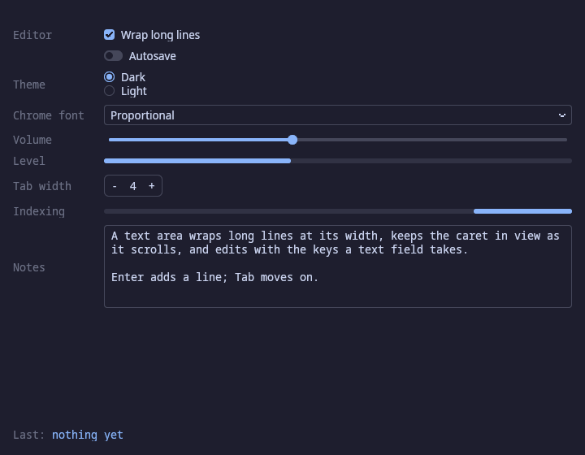

# Misty

A GPU-rendered GUI framework for Rust desktop apps: the window runtime, widgets (a title bar, tabs, and a status bar among them), and themes, drawn with `wgpu`. Out of the box it looks and behaves as a desktop app should, with text in the desktop's interface font and the platform's keys; a keyboard-first app such as an editor, a file manager, or a terminal can opt into Vim and Emacs keys and a monospace cell grid.

> Status: early. The API may change between versions.





## Usage

```bash
cargo add misty
```

A window that clears to a dark background and quits on Escape:

```rust
use misty::{
    AppContext, Application, Error, Frame, Input, Key, KeyCode, Mods, Rgba, WindowId, WindowOptions,
};

struct Hello;

impl Application for Hello {
    type Message = ();

    fn input(&mut self, cx: &mut AppContext<'_, ()>, _window: WindowId, input: &Input) {
        let escape = Input::Key(Key::new(KeyCode::Esc, Mods::NONE));
        if *input == escape || *input == Input::CloseRequested {
            cx.exit();
        }
    }

    fn render(&mut self, _window: WindowId, frame: &mut Frame) {
        frame.clear(Rgba::rgb(0x1e, 0x1e, 0x2e));
    }
}

fn main() -> Result<(), Error> {
    misty::run(Hello, WindowOptions::new("hello"))
}
```

Every item is at the crate root (`misty::Theme`, `misty::Rgba`) except the few namespaces of their own: `misty::picker`, `misty::layout`, `misty::testing`, and `misty::view`.

To build a real app step by step (a list, buttons, dialogs, keys, and tests that run without a display), follow [Getting started](https://github.com/taquangtrung/misty/blob/main/docs/getting-started.md).

More examples are in the repository's [`examples`](https://github.com/taquangtrung/misty/tree/main/examples) folder.

## What it has

- Window runtime: several windows, frameless windows with misty's own title bar, tabs, split panes, and a status bar.
- Widgets: lists, tables, trees, text fields and areas, menus, dialogs, a command palette, which-key hints, toasts, a settings page, and form controls.
- Keyboard: every widget takes the platform's keys, and an app opts into the Vim and Emacs keys with `KeyScheme`. A key notation (`C-x`, `<esc>`, `g g`) and a command registry keep each command's keys and report clashes. Misty resolves no app key presses itself, so an app picks its own keymap library.
- Themes, with theme files in KDL and every built-in word translatable.
- Text: right-to-left and mixed text, and emoji and CJK falling back to whatever system font covers them; wrapped rich paragraphs, justified or aligned, with inline boxes for images and formulas, laid out on worker threads too.
- Accessibility through AccessKit, built afresh every frame.
- Headless tests: with the `testing` feature, feed widgets inputs and read back the text, accessibility tree, and pixels a frame drew, with no display.

## Cargo features

No feature is on by default.

| Feature | Adds |
| --- | --- |
| `dialogs` | `FileDialog`, the system's dialogs to open and save files. |
| `files` | `misty::picker::files`, picker sources over the file system: a folder browser and a scan for kinds of file. |
| `global-hotkey` | `GlobalHotkeys`, keys that reach the app while another app has the focus. |
| `highlight` | `Highlighter`, syntax highlighting for a `CodeView`, through iris. |
| `html` | `Document::from_html`, a safe subset of HTML for `RichText`. |
| `icon-theme` | `IconTheme`, file-type and named icons from the freedesktop icon theme. |
| `kdl` | Theme files in KDL. |
| `markdown` | `Document::from_markdown`, CommonMark for `RichText`. |
| `notify` | `Notification`, desktop notifications. |
| `serde` | Serde for what pickers remember. |
| `single-instance` | `SingleInstance`, a second launch handing its arguments to the running app. |
| `testing` | `misty::testing`, the headless test window. |
| `tray` | `Tray`, an icon in the system tray with a menu. |

## Versioning

Misty re-exports `wgpu` (`misty::wgpu`) for apps that render with the GPU themselves, and `accesskit` (`misty::accesskit`) for the nodes apps describe to screen readers. A new major version of either is a breaking change of misty and is released as one.

## Platforms

Developed and tested on Linux. Windows and macOS are type-checked and built in CI, but not yet tried by hand. A window draws with Vulkan, Metal, or DX12, and falls back to OpenGL when none of them can.

## License

Licensed under either of

- Apache License, Version 2.0 ([LICENSE-APACHE](https://github.com/taquangtrung/misty/blob/main/LICENSE-APACHE))
- MIT license ([LICENSE-MIT](https://github.com/taquangtrung/misty/blob/main/LICENSE-MIT))

at your option.

Unless you explicitly state otherwise, any contribution intentionally submitted for inclusion in the work by you, as defined in the Apache-2.0 license, shall be dual licensed as above, without any additional terms or conditions.
